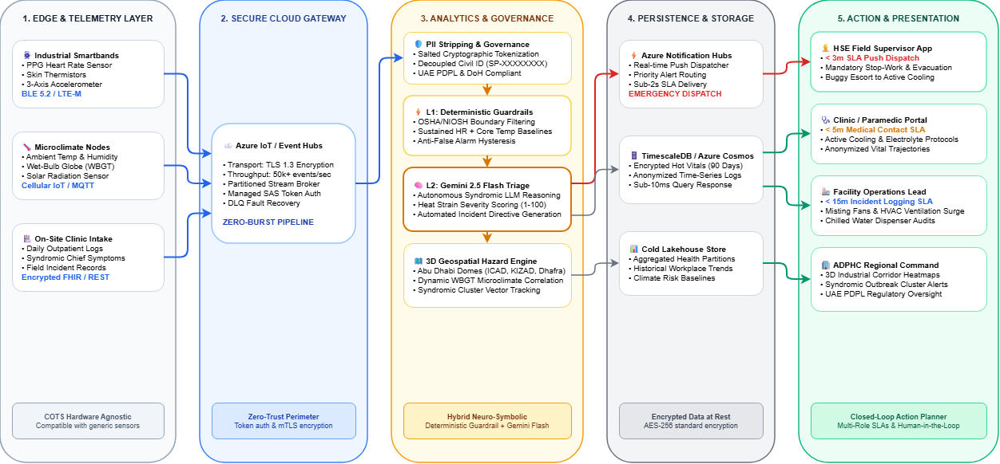

# ⚡ SentinelPulse: Real-Time Workforce Health Early Warning System

> **Submission Track:** Population and Workforce Health Early Warning  
> **Global Initiative:** Future Health Digital Innovation Challenge (Abu Dhabi / GITEX 2026)  
> **Regulatory Alignment:** UAE Federal Decree Law No. 45/2021 (PDPL) & Abu Dhabi Public Health Center (ADPHC)

SentinelPulse is an event-driven telemetry and syndromic anomaly detection platform designed to protect industrial workers in extreme climates from acute heat strain, physical collapse, and occupational hazards.

---

## 🏛️ System Architecture



The platform operates on a **5-Tier Enterprise Cloud Architecture**:

1. **Edge & Telemetry Ingestion Layer:** Ingests live physiological signals (heart rate, core temperature, SpO₂) and environmental microclimate data (Wet Bulb Globe Temperature / WBGT). Supports both continuous 1Hz streaming and batch CSV uploads.
2. **Secure Gateway & Ingestion Boundary:** Enforces TLS 1.3 transport security with cryptographic PII decoupling at ingestion before cloud persistence.
3. **Dual-Tier Analytics & Governance Engine:**
   * **L1 Deterministic Guardrail:** OSHA/NIOSH standard boundary validation to prevent false negatives.
   * **L2 Autonomous Clinical AI:** LLM-assisted syndromic reasoning (Gemini Flash) for dynamic clinical assessment and severity scoring without manual triggers.
4. **Persistence & Aggregation Tier:** Low-latency hot state caching for active physiological telemetry paired with partitioned historical syndromic surveillance logs.
5. **Action & Response Tier:** Sub-2s dispatch to field supervisors and the regional syndromic command center with closed-loop role-based workflows.

---

## 🎯 Reviewer Feedback Implementations

| Reviewer Feedback | Technical Resolution in SentinelPulse |
| :--- | :--- |
| **1. Functional AI Alerting**<br>*(Replace button mocks)* | Replaced static UI triggers with continuous live stream ingestion (1Hz) and batch CSV processing. Out-of-bounds telemetry automatically triggers autonomous clinical triage inference with urgency scoring. |
| **2. Interactive Hazard Map**<br>*(Visualize emerging hazards)* | Integrated a high-performance 3D geospatial layer (PyDeck / Carto Dark) mapping real Abu Dhabi industrial clusters (**ICAD Musaffah, KIZAD Khalifa Port, Al Dhafra Solar Site, Ruwais Complex**) with real-time hazard dome radius expansion based on local WBGT. |
| **3. Prevention Action Planner**<br>*(Role accountability & privacy)* | Built an automated dispatch checklist partitioned by organizational role (**HSE Field Supervisor, Medical/Paramedic, Operations Lead**) with strict SLA targets and zero PII exposure via Salted SHA-256 tokens. |

---

## 🛡️ Privacy Safeguards & Regulatory Compliance

* **Zero Raw PII Exposure:** Worker identification numbers and civil IDs are cryptographically decoupled at Tier 1 using salted SHA-256 tokenization (`SP-XXXXXXXX`).
* **Jurisdiction Compliance:** Adheres to UAE Federal Decree Law No. 45/2021 on Personal Data Protection (PDPL) and Abu Dhabi Department of Health (DoH) healthcare data localization mandates.
* **Explainable Triage Matrix:** Eliminates hallucination risk by gating AI inference behind validated deterministic clinical baselines (OSHA Heat Illness Thresholds).

---

## 👥 Prevention Action Planner (Closed-Loop Matrix)

When physiological stress breaches safety parameters, the system generates dedicated role-based action plans:

* **👷 HSE Field Supervisor (SLA: < 3 Minutes):**
  * Automated stop-work issuance for affected quadrant.
  * Direct buggy dispatch to transport worker to shaded cooling stations.
  * Crew rotation adjustment to mitigate cumulative thermal debt.
* **🩺 On-Site Medical / Paramedic (SLA: < 5 Minutes):**
  * Immediate protocol initiation for evaporative cooling / cold packs.
  * Tympanic/core temperature measurement and electrolyte replenishment.
  * Telemetry transmission to regional emergency dispatch.
* **🏭 Facility Operations Lead (SLA: < 15 Minutes):**
  * Verification of chilled water stations and evaporative misting fans.
  * Quadrant ventilation ramp-up.
  * Automated incident report submission to ADPHC syndromic portal.

---

## 🚀 Quickstart (Deployment & Verification)

### 1. Clone & Setup Environment
```bash
git clone https://github.com/riyankhamdani/sentinelpulse.git
cd sentinelpulse
pip install -r requirements.txt
```

### 2. Configure Credentials (Optional)
SentinelPulse includes deterministic clinical fallbacks. To enable live generative reasoning via Gemini:
```bash
export GEMINI_API_KEY="your-gemini-api-key"
```

### 3. Launch Command Center
```bash
python3 -m streamlit run app.py
```

### 4. Verification Workflow
1. Navigate to the sidebar and toggle **"Enable Live Telemetry Ingestion"**.
2. Shift the heat wave stress slider to **"Extreme Desert Surge"** or upload `sample_telemetry_abu_dhabi.csv`.
3. Verify that the **Geospatial Hazard Map** flags the ICAD cluster, the **Real-Time Telemetry Stream** charts the threshold breach, and the **AI Clinical Triage & Prevention Action Planner** activate automatically.